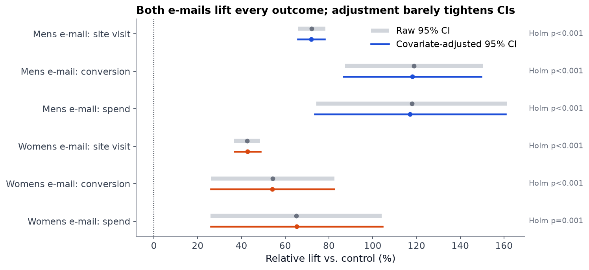
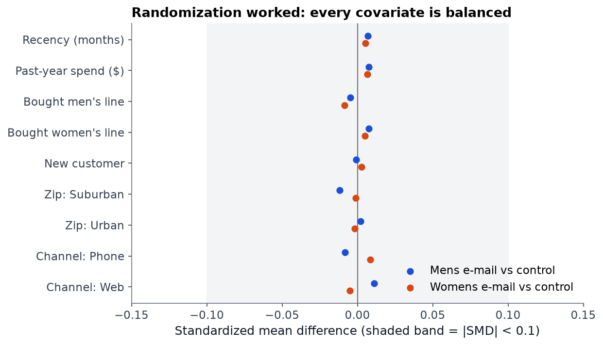
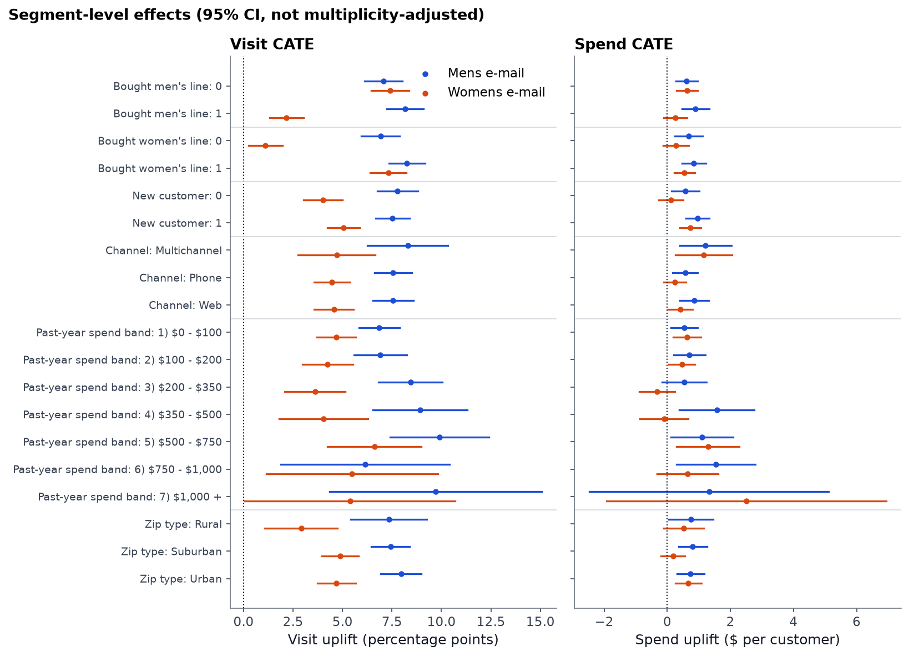
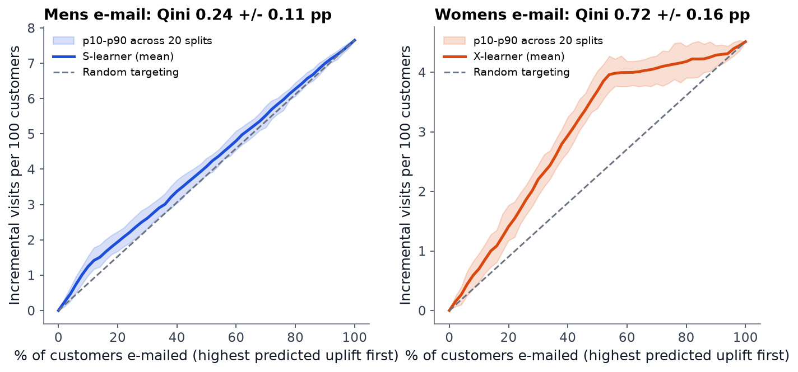
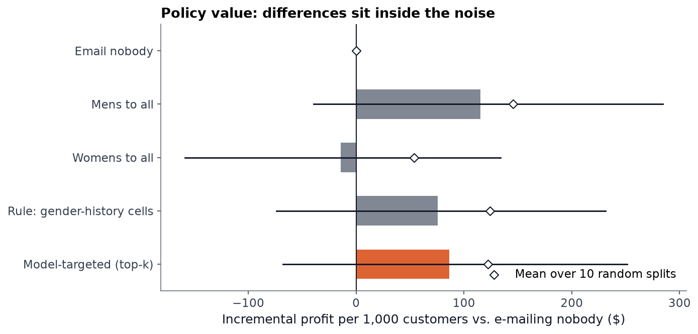

# Who should get the email?

**An A/B test readout and uplift-modeling analysis of a 64,000-customer randomized email experiment, from trust checks to a shipping decision.**

🔗 **[Interactive dashboard](https://soushiki.github.io/data-science/email-uplift/)** · Python · SciPy · statsmodels · scikit-learn



---

## TL;DR

| | |
|---|---|
| **Setup** | 64,000 customers randomly assigned to a men's email, a women's email, or no email. Outcomes are visits, purchases and spend over two weeks. |
| **Trust** | The randomization holds: sample-ratio-mismatch test p = 0.90, and no covariate imbalance above 0.012 SMD. |
| **Readout** | Both emails work. The men's email gives **+72% visits and +$0.77 spend per customer**. All six lifts are significant after Holm correction, and the men's email beats the women's email head-to-head. |
| **Economics** | At $0.10/send and a 30% margin, the men's email earns **$131 per 1,000 customers (95% CI $46–$216)**. The women's email: $27 (CI −$49 to $104). |
| **Targeting** | Uplift models find real heterogeneity for the women's email, but **targeting doesn't beat sending everyone the men's email** (−$29 per 1,000, CI −$98 to +$37). |
| **Decision** | Ship the men's email to the whole list, and don't deploy the uplift model for this campaign. |

## The analysis, in the order a product team would run it

### 1. Can we trust the test?

Run the sample-ratio-mismatch check and the covariate balance check before reading any outcomes. A broken split invalidates everything that follows.



### 2. Did it work?

| Comparison | Visit | Purchase | Spend |
|---|---|---|---|
| Men's email vs. none | +7.7pp (+72%) | +0.68pp (+119%) | +$0.77 (+118%) |
| Women's email vs. none | +4.5pp (+43%) | +0.31pp (+54%) | +$0.42 (+65%) |
| Men's vs. women's | +3.1pp | +0.37pp | +$0.35 (Holm p = 0.03) |

- Spend is 99% zeros, so its confidence intervals come from both Welch's test and a 2,000-resample bootstrap. The two agree.
- **Power:** the minimum detectable spend lift is about $0.40 (around 60% relative). The women's email spend effect was close to the detection limit. Detecting it reliably would need about 15,800 customers per arm.
- **CUPED-style adjustment barely helped** (CIs at most 1.3% narrower), because past purchase behavior explains under 3% of two-week outcomes. That's useful for planning the next test: budget for sample size rather than counting on adjustment.

### 3. For whom does it work?



I tested 24 segment interactions, all specified in advance. Only two survive Holm correction, and both describe one pattern: **the women's email works for customers who already buy women's products** (+7.3pp visits, against +1.1pp for those who don't). The men's email lifts every segment by about the same amount.

That pattern is something a cell-level scan would miss: 64 of 76 segment cells are "significant," but that's only because both emails lift almost everyone. Significance within a segment is not the same as a difference between segments.

### 4. Can a model target better than a rule?



| Learner | Men's email Qini (pp) | Women's email Qini (pp) |
|---|---|---|
| S-learner | **0.24 ± 0.11** | 0.72 ± 0.13 |
| T-learner | 0.12 ± 0.16 | 0.67 ± 0.14 |
| X-learner | 0.11 ± 0.14 | **0.72 ± 0.16** |
| Random (noise floor) | 0.00 ± 0.18 | −0.07 ± 0.19 |

The figures are mean ± sd over 20 random 70/30 splits. Reporting the spread matters, because single-split uplift metrics are notoriously noisy. On **spend**, no learner beats random.

### 5. The decision



Policies are evaluated offline on held-out customers by matching each customer's randomized arm to the policy's recommendation. The top-k cutoff was chosen by cross-validation on training data, and it picked k = 100% in 8 of 10 splits. In other words, the model concluded that everyone should be emailed, and the best email for most people is the men's email.

**Recommendation**
- Send the men's email to everyone.
- Re-test the women's email only on women's-line buyers.
- Revisit uplift targeting when the cost per contact rises (discounts, direct mail). That's when skipping customers who won't respond starts to pay.

## Methodology notes

- **Primary tests:** Welch's t-test for spend, two-proportion z-tests for visit and conversion, and Holm correction across the six arm-vs-control comparisons.
- **Variance reduction:** ANCOVA with pre-period covariates (history, recency, mens, womens, newbie, channel).
- **Heterogeneity:** treatment × segment interaction terms in OLS, corrected with Holm and Benjamini-Hochberg.
- **Uplift:** S-, T- and X-learners built on `HistGradientBoosting`. The holdout is stratified by arm × outcome, and Qini and AUUC are computed against the random-targeting line.
- **Policy evaluation:** arm-matching with known assignment probability 1/3, and paired bootstrap CIs for differences between policies.

## Limitations

- The dataset is a public 2008 experiment ([Kevin Hillstrom / MineThatData](http://www.minethatdata.com/Kevin_Hillstrom_MineThatData_E-MailAnalytics_DataMiningChallenge_2008.03.20.csv)), well known among people who work on uplift modeling. The value of this project is the end-to-end rigor, not a novel dataset.
- The email cost ($0.10) and gross margin (30%) are **illustrative assumptions**, set in [`src/config.py`](src/config.py). Changing them changes the dollar figures but not the ranking of the emails.
- Outcomes cover two weeks. Unsubscribe and long-term effects aren't observed.
- 6,562 rows are exact duplicates. With no customer ID, these are most likely distinct customers with identical attributes, so they are kept.

## Reproduce

```bash
cd projects/email-uplift
python -m venv .venv
.venv/Scripts/pip install -r requirements.txt   # macOS/Linux: .venv/bin/pip
python run_all.py                               # ~30 s
```

```
src/
  fetch_data.py        download + cache the experiment CSV
  clean.py             validation checks, data_quality.json
  experiment.py        SRM, balance, lifts, bootstrap, Holm, ANCOVA, power, segment interactions
  uplift.py            S/T/X-learners, Qini/AUUC over repeated splits
  policy.py            offline policy evaluation with bootstrap CIs
  figures.py           static report figures
  export_dashboard.py  aggregates for the web dashboard
  build_site.py        inlines data into ../../docs/email-uplift/index.html
site/template.html     dashboard source (dependency-free SVG charts)
```
