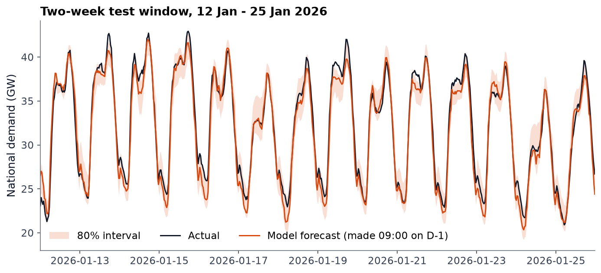
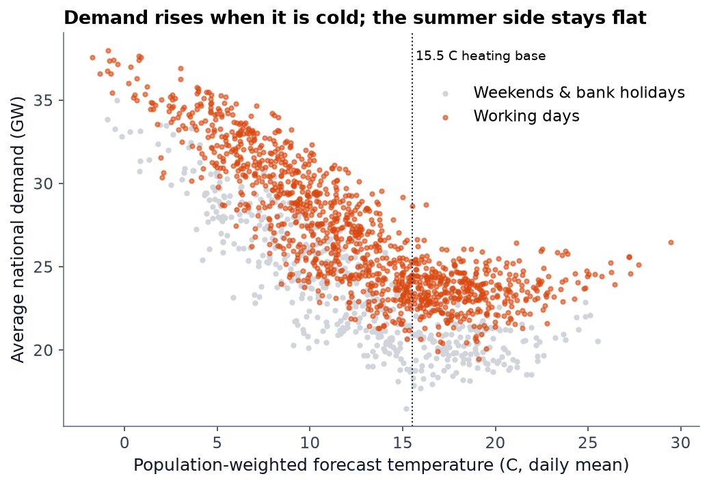
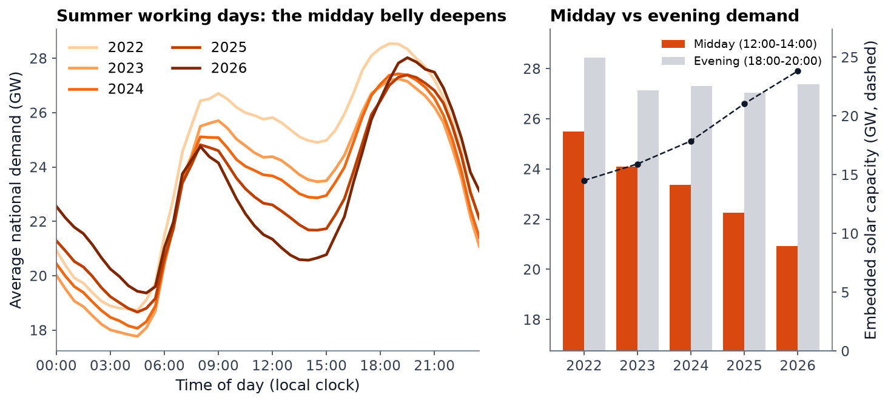
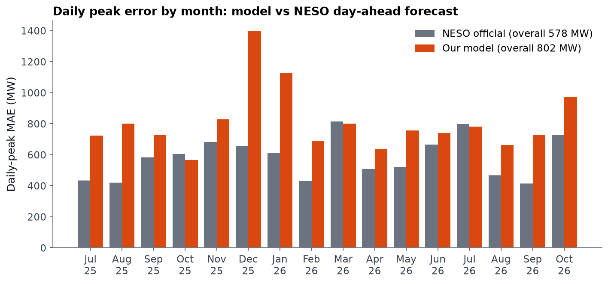

# Can I out-forecast Britain's grid operator?

**A day-ahead electricity demand forecast for Great Britain, compared directly with the official forecast from NESO (National Energy System Operator).**

🔗 **[Interactive dashboard](https://soushiki.github.io/data-science/gb-electricity-demand/)** · Python · pandas · scikit-learn · 4.8 years of half-hourly data



---

## TL;DR

| | |
|---|---|
| **Problem** | Grid operators must schedule generation a day ahead. Every MW of forecast error costs money in balancing actions. |
| **Approach** | Gradient boosting on lagged demand, calendar features and archived **weather forecasts** (not observed weather), issued under the same information cutoff as NESO's real forecast. |
| **Half-hourly result** | **4.2% MAPE** day ahead, half the error of a "same as last week" forecast, with a calibrated 80% interval (79% coverage). |
| **Head-to-head** | On daily peak demand, **NESO wins: 578 MW error against my 802 MW.** NESO was closer in 13 of 16 test months. |
| **The interesting part** | The two forecasts' errors point in different directions, so a fixed 50/50 blend scores **539 MW, 6.7% better than NESO alone**. |

## Why compare against the professionals?

Most forecasting portfolio projects compare against a naive baseline and stop there. A naive baseline is easy to beat. NESO publishes every day-ahead forecast it has issued since 2018, which makes it possible to ask a harder question: *how close can a single person's model get to the national operator's forecast, under the same rules?*

## What drives demand

<p float="left">
  
  
</p>

- **Temperature:** demand rises steeply as it gets colder, because heating switches on, and flattens out above about 15 °C.
- **Rooftop solar:** average summer-weekday midday demand fell from **25.5 GW (2022) to 20.9 GW (2026)** as embedded solar capacity grew from 14.5 GW to 23.8 GW. Evening peaks stayed flat. Solar panels on rooftops don't reduce demand; they hide it from the grid. Any model has to account for that.

## Results (test: Jul 2025 – Oct 2026, never seen during training or tuning)

**Half-hourly forecast** (22,272 half-hours)

| Model | MAE (MW) | MAPE | RMSE (MW) |
|---|---|---|---|
| Same as last week | 2,038 | 8.25% | 2,773 |
| Ridge regression | 1,021 | 4.21% | 1,318 |
| **Gradient boosting** | **1,007** | 4.23% | 1,341 |

Ridge with half-hour interactions essentially ties gradient boosting. Most of the signal is in lagged demand and the daily shape, which a linear model captures well.

**Daily peak vs. NESO** (463 days)

| Forecast | MAE (MW) | MAPE | Bias (MW) |
|---|---|---|---|
| Gradient boosting (mine) | 802 | 2.56% | +44 |
| NESO official | 578 | 1.84% | −190 |
| **50/50 blend** | **539** | **1.72%** | −73 |



### Why the blend works

NESO under-forecasts the peak on average (−190 MW). My model's errors are close to zero overall but run positive in summer. Forecasts whose errors aren't strongly correlated can be averaged to cancel part of the error, the same principle as ensembling models. The blend weight was **fixed at 50/50 in advance** and never tuned on the test set.

### Where my model loses

- **Bank holidays:** +2.3 GW bias over only 9 test days. The model has too few examples to learn a holiday effect.
- **Winter (Dec–Jan):** errors roughly double. Cold snaps and the Christmas period are exactly where NESO's operator judgment and extra inputs matter most.

## Methodology

1. **Data**:
   - [NESO Historic Demand Data](https://www.neso.energy/data-portal/historic-demand-data): half-hourly national demand (ND) from 2022 to Oct 2026, with no gaps. The 46- and 50-period clock-change days are handled with timezone-aware timestamps.
   - [NESO Day Ahead Demand Forecast archive](https://www.neso.energy/data-portal/1-day-ahead-demand-forecast): the official forecasts, first issue at about 08:40 on D-1.
   - [Open-Meteo Historical Forecast API](https://open-meteo.com/en/docs/historical-forecast-api): archived weather *forecasts* for London, Birmingham, Manchester, Leeds, Glasgow and Bristol, population-weighted.
2. **Leakage rules**, enforced in [`src/features.py`](src/features.py):
   - The forecast is issued at 09:00 on D-1. Demand actuals are used only up to the end of D-2, because of publication lag.
   - Weather inputs are forecasts, never observations.
   - A unit check corrupts the D-1 and D actuals and confirms that no feature changes.
3. **Which number to compare**: NESO publishes "cardinal points" (key moments in the daily curve) instead of a full curve, and an explicit daily-peak point only on about 40% of days. The NESO peak is taken as the maximum over its cardinal-point forecasts. The 155 days with an explicit peak point give the same conclusion (626 vs 976 MW). I checked whether NESO forecasts a different demand measure (TSD), which would make the comparison unfair. It doesn't: its forecasts track ND.
4. **Validation**: train 2022–2024, tune on Jan–Jun 2025, refit on train + validation, test once on Jul 2025 – Oct 2026.
5. **Prediction intervals**: quantile gradient boosting (p10/p90) covered only 59% of actuals. A conformal offset (+493 MW) estimated on validation data raises test coverage to 78.9%, close to the 80% target.

## Limitations

- Open-Meteo stitches short-lead forecast runs, so the weather inputs are slightly fresher than a true 09:00 D-1 issue. This favors my model, and it still lost.
- The model has no access to embedded-generation telemetry, interconnector schedules or event calendars, all of which NESO uses.
- A 50/50 blend is the simplest possible combination. Rolling-window stacking weights would be the production approach.

## Next steps

- Model the bank-holiday effect separately, by holiday type and bridge days.
- Forecast embedded solar explicitly (radiation × capacity) and add it back, rather than learning it implicitly.
- Probabilistic peak forecasting for capacity-margin decisions.

## Reproduce

```bash
cd projects/gb-electricity-demand
python -m venv .venv
.venv/Scripts/pip install -r requirements.txt   # macOS/Linux: .venv/bin/pip
python run_all.py
```

```
src/
  fetch_data.py        NESO CKAN API + Open-Meteo historical forecasts, cached
  clean.py             DST-aware timestamps, gap/duplicate checks
  features.py          leakage-safe lags, calendar, weighted weather
  train.py             naive / Ridge / gradient boosting, quantile intervals, NESO head-to-head
  figures.py           static report figures
  export_dashboard.py  aggregates for the web dashboard
  build_site.py        inlines data into ../../docs/gb-electricity-demand/index.html
site/template.html     dashboard source (dependency-free SVG charts)
```
