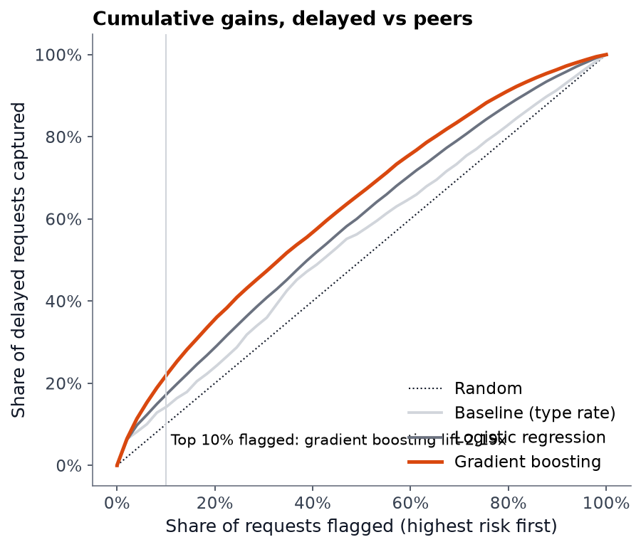
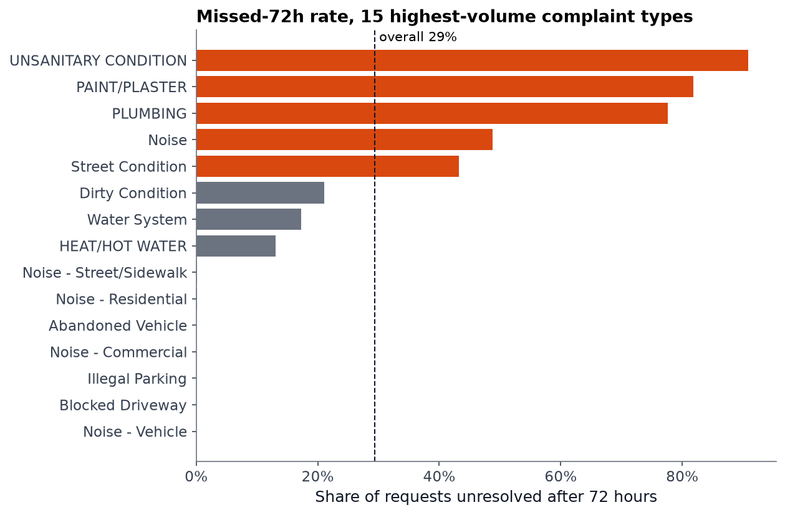
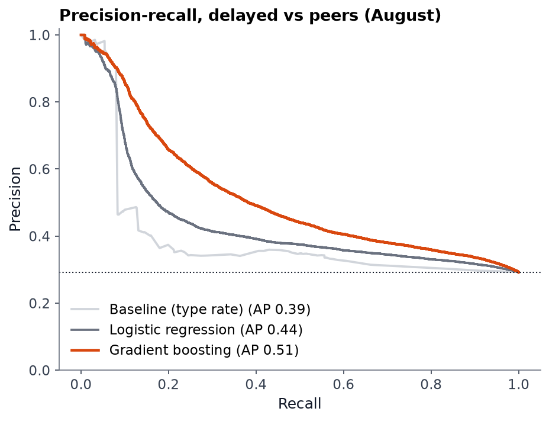
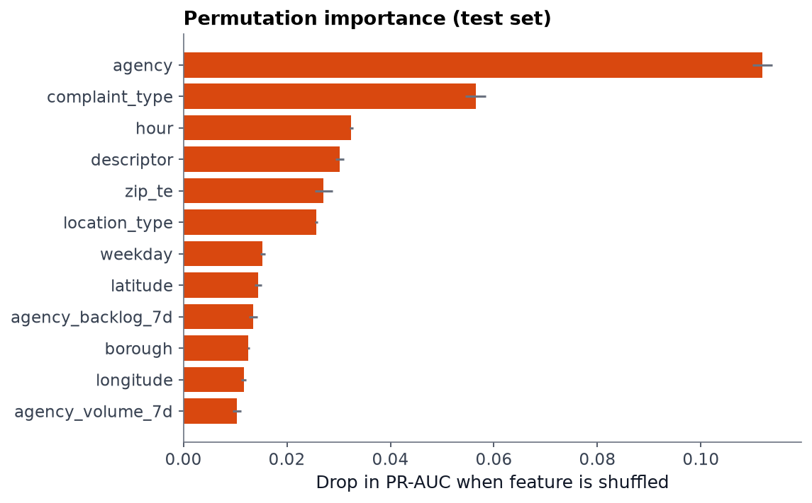
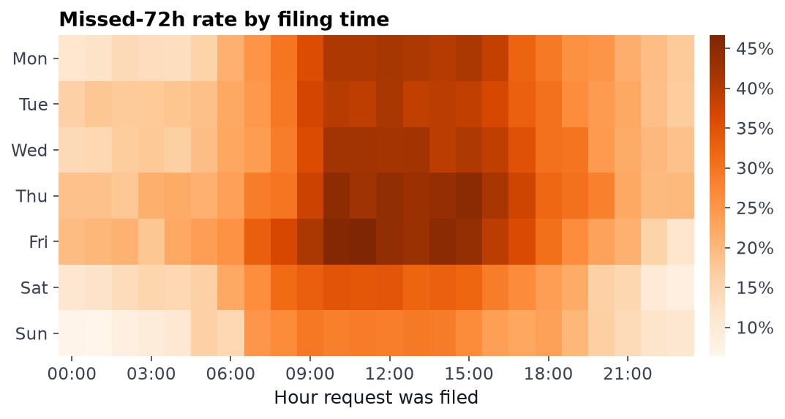

# Which NYC 311 complaints will fall behind?

**Flagging slow-to-resolve city service requests at the moment they're filed, using 6 months of live NYC Open Data.**

🔗 **[Interactive dashboard](https://soushiki.github.io/data-science/nyc-311-delays/)** · Python · pandas · scikit-learn · ~400k requests



---

## TL;DR

| | |
|---|---|
| **Problem** | NYC 311 receives ~330k requests a month. Supervisors can't review them all, so which ones should they look at first? |
| **Key finding** | The obvious target ("will it miss 72 hours?") is almost entirely determined by complaint type. A **lookup table scores ROC-AUC 0.948 and the ML model 0.954**, so the model adds essentially nothing. |
| **Reframe** | Predict which requests will be slower than **others of the same type** (above that type's 75th-percentile time). |
| **Result** | Gradient boosting reaches **ROC-AUC 0.68 and 2.19× lift in the top 10%**: 64% of flagged requests are delayed, against 41% for the lookup table and 29% at random. Evaluated on a held-out future month. |

## Why this project is structured as two studies

Most portfolio projects report the first model that scores well. Here the first model scored **0.95 ROC-AUC**, and a check against a simple baseline showed that the score was not useful:



NYPD closes parking and noise complaints in about 1.5 hours, while HPD housing-condition complaints take weeks. About half of all requests belong to types that almost always or almost never miss 72 hours. A model that only learns "this is a plumbing complaint" can't tell a supervisor anything they don't already know.

**Study 2** removes that shortcut. The threshold for "slow" is set per complaint type (from about 2.5 hours for noise complaints to ~24 days for door/window repairs), so the model has to find signal in *when*, *where* and *under what agency load* a request arrives.

## Results (test set: August 2026, never seen during training or tuning)

**Study 2: delayed vs. peers** (base rate 29.2%, n = 65,088)

| Model | ROC-AUC | PR-AUC | Brier | Precision @10% | Lift @10% |
|---|---|---|---|---|---|
| Lookup table (type rate) | 0.563 | 0.387 | 0.203 | 41.2% | 1.41× |
| Logistic regression | 0.618 | 0.436 | 0.195 | 50.2% | 1.72× |
| **Gradient boosting** | **0.680** | **0.513** | **0.185** | **63.9%** | **2.19×** |

**Study 1: missed 72 hours** (base rate 32.4%)

| Model | ROC-AUC | PR-AUC | Lift @10% |
|---|---|---|---|
| Lookup table | 0.948 | 0.883 | 2.92× |
| Gradient boosting | 0.954 | 0.896 | 2.95× |

<p float="left">
  
  
</p>

## A confounder worth noticing



At first glance this heatmap says that requests filed on weekday mornings get slower service. The more likely explanation is **complaint mix**: slow housing complaints are filed during business hours, and fast noise complaints peak at night and on weekends. Taking the heatmap at face value would lead to a wrong staffing decision. Study 2 accounts for this by comparing each request only with its own type.

## Methodology

1. **Data**: [NYC 311 Service Requests](https://data.cityofnewyork.us/Social-Services/311-Service-Requests-from-2010-to-Present/erm2-nwe9), pulled through the Socrata API for Mar–Aug 2026 (1.98M rows). A deterministic 20% sample (`unique_key` ending in 3 or 7) keeps the dataset laptop-sized and reproducible.
2. **Cleaning** ([`src/clean.py`](src/clean.py)): every rule is logged to [`reports/data_quality.json`](reports/data_quality.json).
   - 129 requests closed *before* they were created were dropped.
   - 8,256 zero-second "auto-closures" were flagged and excluded from Study 2.
   - 13,302 closures at exactly midnight were flagged (likely batch updates).
   - 4.1% of requests were still open after 55+ days. They are counted as missed, not dropped, to avoid survivorship bias.
3. **Features** ([`src/features.py`](src/features.py)): only information available **at filing time**. Closing date, status and resolution text are excluded. Features are agency, complaint type and descriptor, location type, intake channel, hour, weekday, holiday, coordinates, ZIP target encoding (fit on train only), and **agency backlog at filing time** (computed with sorted-array search and checked against a brute-force count).
4. **Validation**: an out-of-time split. Train on Mar–Jun, tune on July, test once on August. Random splits would leak seasonal and backlog patterns.
5. **Models**: a lookup-table baseline, then regularized logistic regression, then `HistGradientBoostingClassifier` with native categorical handling. Interpretation uses permutation importance on the test set.
6. **Metrics**: PR-AUC and precision/recall at a 10% review budget, because the realistic use is a triage queue with limited capacity. The Brier score checks calibration.

## Limitations

- The backlog feature is computed on the 20% sample, so it captures relative load rather than true open counts.
- "Closed" means an agency closed the ticket, not that the issue was fixed.
- July and August ran slower than the training months, so spring-fitted thresholds drift. Production use would need rolling re-fits and drift monitoring.
- ROC-AUC 0.68 is modest. Request-level resolution time depends on a lot that isn't in the data, such as inspector schedules and landlord response. The model's value is in prioritization, not in predicting individual requests precisely.

## Next steps

- Add weather (Open-Meteo) as a feature, since heat and storm events drive surges.
- Use survival analysis (time-to-close with censoring) instead of a binary threshold.
- Serve the model with a small FastAPI endpoint that scores new requests from the live API daily.

## Reproduce

```bash
cd projects/nyc-311-delays
python -m venv .venv
.venv/Scripts/pip install -r requirements.txt   # macOS/Linux: .venv/bin/pip
python run_all.py                               # ~10 min download on first run, then ~1.5 min
```

The run writes the cleaned data to `data/processed/`, models to `models/`, metrics and figures to `reports/`, and the dashboard to the repo-level `docs/nyc-311-delays/index.html` (served by GitHub Pages).

```
src/
  fetch_data.py        Socrata API pull with pagination + retry
  clean.py             data-quality rules, target definitions
  features.py          leakage-safe features, backlog computation
  train.py             time split, 3 models x 2 studies, metrics
  figures.py           static report figures
  export_dashboard.py  aggregates for the web dashboard
  build_site.py        inlines data into ../../docs/nyc-311-delays/index.html
site/template.html     dashboard source (dependency-free SVG charts)
```
